


  

 

<a href="#network"><b>لوکیشن‌ها</b></a> &nbsp;&nbsp;|&nbsp;&nbsp;
<a href="#features"><b>امکانات</b></a> &nbsp;&nbsp;|&nbsp;&nbsp;
<a href="#groups"><b>کانفیگ‌ها</b></a> &nbsp;&nbsp;|&nbsp;&nbsp;
<a href="#panel"><b>پنل</b></a> &nbsp;&nbsp;|&nbsp;&nbsp;
<a href="#sub"><b>ساب‌لینک</b></a> &nbsp;&nbsp;|&nbsp;&nbsp;
<a href="#bot"><b>ربات فروش</b></a> &nbsp;&nbsp;|&nbsp;&nbsp;
<a href="#doctor"><b>پزشک</b></a> &nbsp;&nbsp;|&nbsp;&nbsp;
<a href="#install"><b>نصب</b></a> &nbsp;&nbsp;|&nbsp;&nbsp;
<a href="#faq"><b>سؤالات رایج</b></a>

 

**CHOST** یک پنل پاسارگاد معمولی نیست. نسخه‌ای اختصاصی و دست‌ساز است که از صفحه‌ی ورود تا ربات فروش، با یک هویت طلایی یکدست طراحی شده و فقط با یک دیپلوی روی Railway، کاملاً آماده‌ی فروش بالا می‌آید. پنل، هسته‌ی Xray، صفحه‌ی ساب، سرویس کلید و ربات تلگرام، همه داخل **یک سرویس** و روی **یک پورت** اجرا می‌شوند.

> [!TIP]
> روی هر چهار لوکیشن Railway (آمستردام، ویرجینیا، کالیفرنیا و سنگاپور) کار می‌کند. کانفیگ‌ها خودکار روی دامنه‌ی همان سرویس ساخته می‌شوند، حتی اگر دامنه را بعد از دیپلوی بسازید، و هر کاربری که بدون گروه ساخته شود خودکار هر شش کانفیگ را می‌گیرد؛ پس ساب‌لینک هیچ‌وقت خالی نمی‌ماند.
>
> نصب حدود 3 دقیقه طول می‌کشد، بدون ترمینال و بدون SSH. بعد از بالا آمدن، شش کانفیگ، دو گروه، ده قالب فروش و صفحه‌ی ساب از قبل ساخته شده‌اند؛ فقط کاربر بسازید و بفروشید.

 



  


  


  


 

<b>جزئیات فنی کانفیگ‌ها</b>

 

| گروه | کانفیگ | پروتکل | انتقال | اثر انگشت |
|:--|:--|:--:|:--:|:--:|
| **CHOST VIP** | Turbo | VLESS | WebSocket | chrome |
| | Stream | VMess | WebSocket | firefox |
| | Ultra | VLESS | HTTPUpgrade | safari |
| **CHOST GAME** | Gaming | VLESS | WebSocket | chrome |
| | Call | Trojan | WebSocket | edge |
| | Stable | VLESS | HTTPUpgrade | ios |

همه روی **TLS 443** با دامنه‌ی خود Railway و با مسیرهای تصادفیِ مخصوص هر نصب. قالب‌های فروش آماده: VIP با 10، 30، 50، 100 و 200 گیگ و نامحدود؛ GAME با 20، 50 و 100 گیگ و نامحدود.

 


 

<b>پنل نمایندگی، کلید مالک و دوزبانه</b>

 

**پنل نمایندگی** درست مثل بقیه‌ی بخش‌ها در منوی کناری پنل قرار دارد. مالک برای هر نماینده یک حساب جدا با سهمیه‌ی حجم می‌سازد، سهمیه را افزایش می‌دهد، رمز را عوض می‌کند یا حساب را غیرفعال می‌کند. هر نماینده فقط کاربرهای خودش را می‌بیند و فقط با قالب‌های آماده کاربر می‌سازد. وقتی سهمیه تمام شود، کاربران آن نماینده خودکار متوقف می‌شوند.

**کلید مالک** برای روزی است که رمز فراموش شده: سرویس را ری‌استارت کنید، کلید را از لاگ بردارید و در صفحه‌ی ورود روی «دسترسی مالک» بزنید. کلید فقط 5 دقیقه اعتبار دارد، یک‌بارمصرف است، به‌صورت رمزنگاری‌شده ذخیره می‌شود و بعد از 5 تلاش اشتباه قفل می‌شود.

**دوزبانه:** با عوض کردن زبان پنل، همه‌ی بخش‌های CHOST (منو، صفحه‌ها، پنجره‌ها، پیغام‌ها و حتی خطاهای سرور) همان لحظه و بدون رفرش به انگلیسی یا فارسی تغییر می‌کنند و جهت صفحه هم درست می‌شود.

 


  


 

<b>همه‌ی امکانات ربات فروش</b>

 

| بخش | توضیح |
|:--|:--|
| **فروش** | انتخاب پلن، فاکتور با دکمه‌ی کپی، ارسال رسید، تأیید یا رد با ذکر دلیل، ساخت خودکار اشتراک |
| **کیف پول** | شارژ با کارت‌به‌کارت، خرید و تمدید فوری بدون رسید، بازگشت خودکار وجه در صورت خطا |
| **سیستم دعوت** | لینک اختصاصی هر کاربر، پورسانت درصدی از هر خرید دعوت‌شده‌ها به کیف پول |
| **مدیریت کاربران** | جست‌وجو با آیدی یا یوزرنیم، افزایش و کاهش موجودی، پیام مستقیم، مسدود کردن |
| **تمدید** | تمدید از «اشتراک‌های من»؛ مصرف فقط بعد از ذخیره‌ی موفق صفر می‌شود |
| **کد تخفیف** | درصدی، با سقف استفاده، هر کاربر یک بار |
| **اکانت تست** | یک بار برای هر کاربر، حجم و مدت قابل تنظیم |
| **یادآوری** | کمتر از 3 روز، یا کمتر از 10 درصد حجم، یا کمتر از 1 گیگ |
| **بکاپ** | فایل کامل پنل و ربات، روزانه و دستی، در تلگرام مدیر |
| **مدیریت** | پلن‌ها، قیمت، شماره کارت، متن‌ها، عضویت اجباری کانال، پیام همگانی، باز و بسته کردن فروش |

 


 

<b>پزشک CHOST دقیقاً چه کار می‌کند؟</b>

 

| بررسی | اگر خراب شود |
|:--|:--|
| کانفیگ‌ها و دامنه | کانفیگ خاموش، پاک‌شده یا روی دامنه‌ی قدیمی همان لحظه از نو ساخته می‌شود |
| ساب‌لینک | اگر ساب‌لینک کاربری خالی باشد، کانفیگ‌ها دوباره ساخته می‌شوند؛ اگر صفحه‌ی ساب خطا بدهد، یک صفحه‌ی ساده و مطمئن جایش می‌نشیند تا لینک‌ها همیشه باز شوند |
| کاربر بدون گروه | خودکار هر شش کانفیگ را می‌گیرد |
| هسته‌ی اتصال | اگر قطع شود، خودکار دوباره وصل می‌شود |
| پنل، nginx، ربات | هر بخشی که بایستد، فقط همان بخش در چند ثانیه دوباره راه می‌افتد؛ خود سرویس ری‌استارت نمی‌شود |
| حافظه (رم) | قبل از اینکه رم سرویس پر شود، اول ربات و در صورت نیاز پنل را تازه می‌کند تا ریلوی هیچ‌وقت سرویس را از کار نیندازد؛ کانفیگ‌ها وصل می‌مانند |
| تنظیمات nginx | اگر nginx تنظیمی را قبول نکند، تنظیمات اضافه کنار می‌رود و در صورت نیاز یک تنظیم ساده و مطمئن جایش می‌نشیند؛ اگر باز هم بالا نیاید، درگاه داخلی CHOST جای nginx را می‌گیرد تا پنل، ساب‌لینک و کانفیگ‌ها همیشه باز شوند |
| پایگاه داده | هر 6 ساعت و قبل از هر به‌روزرسانی یک نسخه‌ی سالم روی Volume ذخیره می‌شود (4 نسخه‌ی آخر)؛ اگر پایگاه داده خراب شود، آخرین نسخه‌ی سالم خودکار برمی‌گردد |
| فضای Volume | اگر فضا نزدیک پر شدن باشد، نسخه‌های قدیمی و فایل‌های اضافه پاک می‌شوند تا پنل بتواند بنویسد |
| پورت و شبکه | پنل روی پورت 8080 و پورت‌های رایج دیگر جواب می‌دهد و اگر لوکیشنی IPv6 نداشت، خودش روی IPv4 بالا می‌آید |

تعمیر کانفیگ‌ها، ساب‌لینک و کاربرها با یک پیام کوتاه فارسی در تلگرام به مدیرهای ربات خبر داده می‌شود (هر مشکل حداکثر یک بار در ساعت)؛ بقیه‌ی تعمیرها در لاگ Railway نوشته می‌شوند.


 

| بخش | آدرس |
|:--|:--|
| پنل | `https://<your-app>.up.railway.app/dashboard/` |
| ساب‌لینک | `https://<your-app>.up.railway.app/sub/<token>` |

<b>بعد از نصب، این 4 کار را انجام دهید</b>

 

1. از منوی کناری، **امنیت حساب**: رمز پیش‌فرض را عوض کنید.
2. از منوی کناری، **ربات تلگرام**: توکن و آیدی عددی مدیر را وارد کنید.
3. در تلگرام دستور `/admin` را به ربات بفرستید و قیمت‌ها و شماره کارت را تنظیم کنید.
4. یک کاربر آزمایشی بسازید و ساب‌لینکش را روی گوشی باز کنید.

> [!IMPORTANT]
> ورود اولیه با نام کاربری `admin` و رمز `admin` است. پنل روی اینترنت باز است؛ بلافاصله بعد از اولین ورود، از منوی کناری، بخش **امنیت حساب** رمز را عوض کنید.

<b>متغیرهای اختیاری</b>

 

| متغیر | پیش‌فرض | توضیح |
|:--|:--:|:--|
| `PORT` | `8080` | پورت سرویس؛ پورت دامنه در Settings ← Networking هم باید همین باشد (پیشنهادی) |
| `CONFIG_TITLE` | `CHOST` | نام اشتراک داخل برنامه‌ها |
| `SUBSCRIPTION_PATH` | `sub` | مسیر ساب‌لینک |
| `DEMO_RESELLER` | `on` | ساخت نماینده‌ی نمونه با 50 گیگ سهمیه |
| `AUTO_GROUP` | `on` | کاربری که بدون گروه ساخته شود، خودکار هر 6 کانفیگ (هر دو گروه) را می‌گیرد |

## سؤالات رایج

<b>پینگ چقدر است؟</b>

 
بسته به اپراتور و لوکیشن Railway؛ معمولاً TCP بین 80 تا 150 و Real Delay بین 150 تا 300 میلی‌ثانیه. صفحه‌ی ساب پینگ واقعی را نشان می‌دهد، نه عدد ساختگی.

<b>روی کدام لوکیشن و اپراتور کار می‌کند؟</b>

 
همه‌ی لوکیشن‌های Railway (آمستردام، ویرجینیا، کالیفرنیا و سنگاپور) با IPv4 و IPv6. پنل خودش پورت، دامنه، شبکه‌ی IPv4 یا IPv6 و تعداد پردازنده‌ی همان لوکیشن را تشخیص می‌دهد؛ برای عوض کردن لوکیشن کافی است در Settings ریجن را عوض کنید، کانفیگ‌ها خودکار روی همان دامنه بالا می‌آیند. شش کانفیگ عمداً متفاوت ساخته شده‌اند تا روی همراه اول، ایرانسل، رایتل و اینترنت ثابت، اگر یکی محدود شد، بقیه وصل بمانند.

<b>بعد از دیپلوی، پنل کی باز می‌شود؟</b>

 
اولین بار حدود 1 تا 2 دقیقه طول می‌کشد. اگر زودتر باز کنید، صفحه‌ی «پنل در حال آماده شدن است» را می‌بینید که خودش تازه می‌شود و پنل را باز می‌کند؛ هیچ صفحه‌ی خطایی نمی‌بینید. کافی است خود دامنه را باز کنید، مستقیم به پنل می‌روید.

<b>ربات بعد از وارد کردن توکن کی روشن می‌شود؟</b>

 
همان لحظه. بعد از ذخیره، وضعیت ربات در همان صفحه به «آنلاین» تغییر می‌کند و نیازی به ری‌استارت نیست.

<b>سرویس خودش ری‌استارت می‌شود؟</b>

 
خیر. هر بخش (پنل، هسته، nginx، ربات) زیر نظر خودش اجرا می‌شود؛ اگر یکی بایستد، فقط همان بخش در چند ثانیه دوباره راه می‌افتد و کاربرها قطع نمی‌شوند.

<b>پنل انگلیسی هم دارد؟</b>

 
بله. زبان پنل را عوض کنید؛ همه‌ی بخش‌های CHOST هم همراهش عوض می‌شوند. صفحه‌ی ساب هم فارسی و انگلیسی دارد.

<b>چرا Reality یا Hysteria ندارد؟</b>

 
Railway فقط یک پورت HTTPS بیرون می‌دهد؛ پس فقط WebSocket و HTTPUpgrade پشت TLS پایدار کار می‌کنند.

<b>سرعت به چه چیزی بستگی دارد؟</b>

 
به شبکه و پلن Railway. پنل هیچ محدودیت سرعتی اعمال نمی‌کند.

<b>بکاپ را چطور برگردانم؟</b>

 
سرویس را متوقف کنید، فایل‌های زیپ بکاپ را در Volume جایگزین کنید و دوباره روشن کنید. راهنمای کوتاه داخل خود زیپ هم هست.

<b>با ری‌استارت کاربرها پاک می‌شوند؟</b>

 
خیر، به شرط اینکه Volume ساخته شده باشد.

 

<a href="INSTALL.md">راهنمای نصب</a> &nbsp;|&nbsp; <a href="FAQ.md">سؤالات کامل</a> &nbsp;|&nbsp; <a href="TROUBLESHOOTING.md">عیب‌یابی</a> &nbsp;|&nbsp; <a href="SECURITY.md">امنیت</a> &nbsp;|&nbsp; <a href="CHANGELOG.md">تغییرات</a>

 

  

© 2026 CHOST. همه‌ی حقوق محفوظ است. بر پایه‌ی پروژه‌ی متن‌باز PasarGuard.

